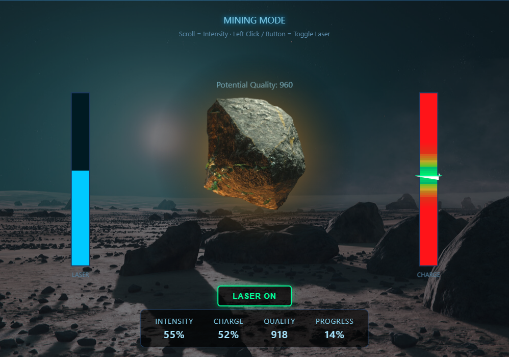

DISCLAIMER: the code was made with help of an AI to make it quickly.

This is a very simple simulation of SC mining, reworking the way a player obtains ores rewarding his precision skill with a higher quality material.

It is obviously very simplified, as it just needs to showcase how the player precision in keeping the laser near the hotspot affects the quality of the ore, a simple change that could allow the existence of higher quality ores but with harder greenzones and higher instabilities.

You DON'T need to download the images, but if you do, remember to put all the files in the same folder.
Just double click the mining.html file to try locally.

